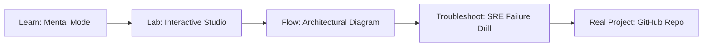

# Vault Secrets Studio

> **Production Learning Guide, Interactive Lab & Real-Time Incident Drills**

| Property | Value |
|---|---|
| **Domain** | `Zero-Trust Security & DevSecOps` |
| **Category** | `AUTOMATION` |
| **Skill Level** | `Level 3 (Distributed & Compliance)` |
| **Target SRE Metric** | `Zero Plaintext Secrets in Git & Automated 30-Day Key Rotation` |
| **Artifact Target** | `vault-policy.hcl` |
| **Source Repository** | [Pradeeptalari14/tp-vault-secrets](https://github.com/Pradeeptalari14/tp-vault-secrets) |
| **Interactive Studio** | [Launch In-Browser Lab](./index.html) |

---

## 1. Overview & Architectural Mission

Configure dynamic secrets engines and PKI certificate authorities. Manage dynamic credentials databases roles, and simulate automated lease TTL countdowns.

### Core Production Use Case
Securing API tokens, database passwords, and cryptographic keys across distributed microservices with automated rotation.



---

## 2. Best Architectural Treatment vs. Anti-Pattern

### Recommended Production Practice
> [!TIP]
> Store credentials in HashiCorp Vault with short-lived dynamic lease times, injecting secrets into pods via ephemeral volume mounts or CSI drivers.

### Dangerous Anti-Pattern to Avoid
> [!WARNING]
> Storing plaintext credentials in Git repositories, unencrypted Kubernetes ConfigMaps, or long-lived environment variables.

---

## 3. Real-Time SRE Incident Drill

**Target Failure Mode:**
vault kv put secret/production/db password="$(openssl rand -hex 24)" && vault kv get secret/production/db

### Drill Execution Checklist
1. **Baseline Telemetry:** Verify health metrics against the target SLO threshold before initiating changes.
2. **Failure Injection:** Introduce synthetic latency or simulated drift in a non-production staging boundary.
3. **Automated Alerting:** Validate that alerts trigger within `< 30s` via OpenTelemetry collector.
4. **Controlled Remediation:** Apply pre-reviewed, non-destructive configuration changes.
5. **Post-Mortem & Runbook Update:** Update the team runbook with observed failure patterns.

---

## 4. Production Configuration & Code Artifact (`vault-policy.hcl`)

```hcl
# Terraform / HCL Configuration: Vault Secrets Studio
# Domain: Zero-Trust Security & DevSecOps
# Target Artifact: vault-policy.hcl

terraform {
  required_version = ">= 1.8.0"
  required_providers {
    aws = {
      source  = "hashicorp/aws"
      version = "~> 5.50"
    }
  }
}

locals {
  service_name = "vault-secrets-studio"
  sre_standard = "Zero Plaintext Secrets in Git & Automated 30-Day Key Rotation"
}

resource "aws_service_mesh" "core" {
  name = local.service_name
  tags = {
    Environment = "production"
    ManagedBy   = "Terraform"
    SRE_Metric  = local.sre_standard
  }
}
```

---

## 5. Navigation & Next Steps

- **Interactive Simulator:** [Open Vault Secrets Studio Studio](./index.html)
- **Web Learning View:** [Interactive Guide](./learn.html)
- **GitHub Project Repository:** [Pradeeptalari14/tp-vault-secrets](https://github.com/Pradeeptalari14/tp-vault-secrets)
- **Master Studio Index:** [All 347 Studios](../../STUDIOS_CATALOGUE.md)

