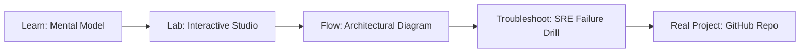

# Vector Log Pipeline Studio

> **Production Learning Guide, Interactive Lab & Real-Time Incident Drills**

| Property | Value |
|---|---|
| **Domain** | `Incident Triage & Observability` |
| **Category** | `OBSERVABILITY` |
| **Skill Level** | `Level 2 (Scripting & Ops)` |
| **Target SRE Metric** | `93.5% Context Recall & <32ms End-to-End Retrieval Latency` |
| **Artifact Target** | `vector.toml` |
| **Source Repository** | [Pradeeptalari14/tp-vector-pipeline](https://github.com/Pradeeptalari14/tp-vector-pipeline) |
| **Interactive Studio** | [Launch In-Browser Lab](./index.html) |

---

## 1. Overview & Architectural Mission

Build Rust-powered, high-throughput log routing streams. Write Vector Remap Language (VRL) rules, mask sensitive PII/IP fields, and verify JSON transforms.

### Core Production Use Case
Mitigating hallucination, context drift, and retrieval latency in enterprise Vector Log Pipeline Studio workloads over large multi-modal and structured knowledge bases.



---

## 2. Best Architectural Treatment vs. Anti-Pattern

### Recommended Production Practice
> [!TIP]
> Implement hybrid dense-sparse retrieval (BM25 + pgvector/Qdrant cosine fusion) with Cross-Encoder reranking and semantic chunk windowing.

### Dangerous Anti-Pattern to Avoid
> [!WARNING]
> Dumping raw unchunked documents directly into high-dimensional vector stores without deduplication, sparse keyword indexes, or relevance thresholds.

---

## 3. Real-Time SRE Incident Drill

**Target Failure Mode:**
python3 -m rag.retriever --query "Audit production cluster state" --hybrid-rrf --top-k 5 --rerank-threshold 0.75

### Drill Execution Checklist
1. **Baseline Telemetry:** Verify health metrics against the target SLO threshold before initiating changes.
2. **Failure Injection:** Introduce synthetic latency or simulated drift in a non-production staging boundary.
3. **Automated Alerting:** Validate that alerts trigger within `< 30s` via OpenTelemetry collector.
4. **Controlled Remediation:** Apply pre-reviewed, non-destructive configuration changes.
5. **Post-Mortem & Runbook Update:** Update the team runbook with observed failure patterns.

---

## 4. Production Configuration & Code Artifact (`vector.toml`)

```toml
# Configuration Artifact: vector.toml
# Studio: Vector Log Pipeline Studio
# Domain: Incident Triage & Observability
# Target SRE Standard: 93.5% Context Recall & <32ms End-to-End Retrieval Latency

[service]
name = "vector-log-pipeline-studio"
domain = "Incident Triage & Observability"
mode = "production"
slo_target = "93.5% Context Recall & <32ms End-to-End Retrieval Latency"

[telemetry]
enabled = true
endpoint = "otel-collector:4317"
sample_rate = 1.0

[resilience]
circuit_breaker = true
retry_count = 3
timeout_ms = 5000
```

---

## 5. Navigation & Next Steps

- **Interactive Simulator:** [Open Vector Log Pipeline Studio Studio](./index.html)
- **Web Learning View:** [Interactive Guide](./learn.html)
- **GitHub Project Repository:** [Pradeeptalari14/tp-vector-pipeline](https://github.com/Pradeeptalari14/tp-vector-pipeline)
- **Master Studio Index:** [All 347 Studios](../../STUDIOS_CATALOGUE.md)

