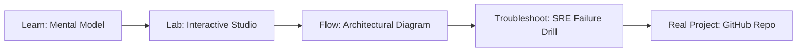

# vpage3-core

> **Production Learning Guide, Interactive Lab & Real-Time Incident Drills**

| Property | Value |
|---|---|
| **Domain** | `LLMOps & RAG Pipelines` |
| **Category** | `AI` |
| **Skill Level** | `Level 3 (Distributed & Compliance)` |
| **Target SRE Metric** | `99.95% Availability SLO & 100% Audited Reproducibility` |
| **Artifact Target** | `change_detector.ts` |
| **Source Repository** | [Pradeeptalari14/tp-vpage3-core](https://github.com/Pradeeptalari14/tp-vpage3-core) |
| **Interactive Studio** | [Launch In-Browser Lab](./index.html) |

---

## 1. Overview & Architectural Mission

Fast incremental crawler checking content hashes and invalidating stale indexes.

### Core Production Use Case
Production engineering: Deploying resilient, schema-validated vpage3-core services with audited compliance and zero-drift operational reliability.



---

## 2. Best Architectural Treatment vs. Anti-Pattern

### Recommended Production Practice
> [!TIP]
> Standardize on version-controlled declarations (change_detector.ts), enforce automated validation before commit, and monitor runtime telemetry against target SLOs.

### Dangerous Anti-Pattern to Avoid
> [!WARNING]
> Manual ad-hoc configuration adjustments in live environments without versioned state manifests or automated rollback testing.

---

## 3. Real-Time SRE Incident Drill

**Target Failure Mode:**
bash scripts/validate.sh --manifest change_detector.ts --verify-health --environment production

### Drill Execution Checklist
1. **Baseline Telemetry:** Verify health metrics against the target SLO threshold before initiating changes.
2. **Failure Injection:** Introduce synthetic latency or simulated drift in a non-production staging boundary.
3. **Automated Alerting:** Validate that alerts trigger within `< 30s` via OpenTelemetry collector.
4. **Controlled Remediation:** Apply pre-reviewed, non-destructive configuration changes.
5. **Post-Mortem & Runbook Update:** Update the team runbook with observed failure patterns.

---

## 4. Production Configuration & Code Artifact (`change_detector.ts`)

```toml
# Configuration Artifact: change_detector.ts
# Studio: vpage3-core
# Domain: LLMOps & RAG Pipelines
# Target SRE Standard: 99.95% Availability SLO & 100% Audited Reproducibility

[service]
name = "vpage3-core"
domain = "LLMOps & RAG Pipelines"
mode = "production"
slo_target = "99.95% Availability SLO & 100% Audited Reproducibility"

[telemetry]
enabled = true
endpoint = "otel-collector:4317"
sample_rate = 1.0

[resilience]
circuit_breaker = true
retry_count = 3
timeout_ms = 5000
```

---

## 5. Navigation & Next Steps

- **Interactive Simulator:** [Open vpage3-core Studio](./index.html)
- **Web Learning View:** [Interactive Guide](./learn.html)
- **GitHub Project Repository:** [Pradeeptalari14/tp-vpage3-core](https://github.com/Pradeeptalari14/tp-vpage3-core)
- **Master Studio Index:** [All 347 Studios](../../STUDIOS_CATALOGUE.md)

