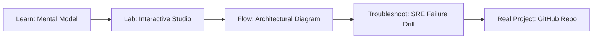

# WebWatcher

> **Production Learning Guide, Interactive Lab & Real-Time Incident Drills**

| Property | Value |
|---|---|
| **Domain** | `LLMOps & RAG Pipelines` |
| **Category** | `AI` |
| **Skill Level** | `Level 3 (Distributed & Compliance)` |
| **Target SRE Metric** | `99.95% Availability SLO & 100% Audited Reproducibility` |
| **Artifact Target** | `url_watcher.py` |
| **Source Repository** | [Pradeeptalari14/tp-webwatcher](https://github.com/Pradeeptalari14/tp-webwatcher) |
| **Interactive Studio** | [Launch In-Browser Lab](./index.html) |

---

## 1. Overview & Architectural Mission

BeautifulSoup crawler checking site ETag updates and enqueueing changed files for re-indexing.

### Core Production Use Case
Production engineering: Deploying resilient, schema-validated WebWatcher services with audited compliance and zero-drift operational reliability.



---

## 2. Best Architectural Treatment vs. Anti-Pattern

### Recommended Production Practice
> [!TIP]
> Standardize on version-controlled declarations (url_watcher.py), enforce automated validation before commit, and monitor runtime telemetry against target SLOs.

### Dangerous Anti-Pattern to Avoid
> [!WARNING]
> Manual ad-hoc configuration adjustments in live environments without versioned state manifests or automated rollback testing.

---

## 3. Real-Time SRE Incident Drill

**Target Failure Mode:**
bash scripts/validate.sh --manifest url_watcher.py --verify-health --environment production

### Drill Execution Checklist
1. **Baseline Telemetry:** Verify health metrics against the target SLO threshold before initiating changes.
2. **Failure Injection:** Introduce synthetic latency or simulated drift in a non-production staging boundary.
3. **Automated Alerting:** Validate that alerts trigger within `< 30s` via OpenTelemetry collector.
4. **Controlled Remediation:** Apply pre-reviewed, non-destructive configuration changes.
5. **Post-Mortem & Runbook Update:** Update the team runbook with observed failure patterns.

---

## 4. Production Configuration & Code Artifact (`url_watcher.py`)

```python
"""
Production Implementation: WebWatcher
Domain: LLMOps & RAG Pipelines
Target Artifact: url_watcher.py
Repository: https://github.com/Pradeeptalari14/tp-webwatcher
SRE Target: 99.95% Availability SLO & 100% Audited Reproducibility
"""
import os
import sys
import logging
from typing import Dict, Any

logging.basicConfig(level=logging.INFO, format="%(asctime)s [%(levelname)s] %(message)s")
logger = logging.getLogger("webwatcher")

class ProductionConfig:
    SERVICE_NAME = "webwatcher"
    ENVIRONMENT = os.getenv("APP_ENV", "production")
    WORKER_CONCURRENCY = int(os.getenv("CONCURRENCY", "16"))
    TIMEOUT_SECONDS = int(os.getenv("TIMEOUT_SEC", "30"))
    TELEMETRY_ENDPOINT = os.getenv("OTEL_EXPORTER_OTLP_ENDPOINT", "http://otel-collector:4317")

def initialize_runtime() -> Dict[str, Any]:
    logger.info("Bootstrapping %s runtime with verified parameters...", ProductionConfig.SERVICE_NAME)
    context = {
        "service": ProductionConfig.SERVICE_NAME,
        "concurrency": ProductionConfig.WORKER_CONCURRENCY,
        "slo_threshold": "99.95% Availability SLO & 100% Audited Reproducibility",
        "healthy": True
    }
    logger.info("Runtime initialized successfully: %s", context)
    return context

if __name__ == "__main__":
    ctx = initialize_runtime()
    print("Runtime ready for traffic.")
```

---

## 5. Navigation & Next Steps

- **Interactive Simulator:** [Open WebWatcher Studio](./index.html)
- **Web Learning View:** [Interactive Guide](./learn.html)
- **GitHub Project Repository:** [Pradeeptalari14/tp-webwatcher](https://github.com/Pradeeptalari14/tp-webwatcher)
- **Master Studio Index:** [All 347 Studios](../../STUDIOS_CATALOGUE.md)

