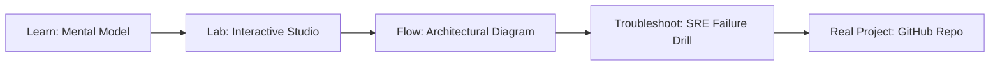

# 01.AI Yi-Lightning MoE Studio

> **Production Learning Guide, Interactive Lab & Real-Time Incident Drills**

| Property | Value |
|---|---|
| **Domain** | `LLMOps & AI Runtime` |
| **Category** | `AI` |
| **Skill Level** | `Level 4 (Kernel & Deep AI)` |
| **Target SRE Metric** | `4.5x Prefix Prefill Throughput & 88% KV-Cache Hit Ratio` |
| **Artifact Target** | `moe-router.json` |
| **Source Repository** | [Pradeeptalari14/tp-yi-lightning-moe](https://github.com/Pradeeptalari14/tp-yi-lightning-moe) |
| **Interactive Studio** | [Launch In-Browser Lab](./index.html) |

---

## 1. Overview & Architectural Mission

Fine-grained Mixture-of-Experts serving blueprint inspired by Yi-Lightning: aux-loss-free expert routing, bilingual token budgeting and SGLang expert parallelism.

### Core Production Use Case
Multi-turn agent swarms and repetitive chain-of-thought workflows where system prompts and tools definitions are repeated across thousands of consecutive LLM calls.



---

## 2. Best Architectural Treatment vs. Anti-Pattern

### Recommended Production Practice
> [!TIP]
> Maintain a Radix Tree KV-cache index across requests, allowing automatic prefix matching, instant KV reuse, and zero recomputation of static prompt prefixes.

### Dangerous Anti-Pattern to Avoid
> [!WARNING]
> Re-tokenizing and running full transformer prefill passes on the exact same 3,000-token system prompt across every single agent step.

---

## 3. Real-Time SRE Incident Drill

**Target Failure Mode:**
python3 -m sglang.launch_server --model-path meta-llama/Llama-3-8B-Instruct --port 30000 --enable-cache-report

### Drill Execution Checklist
1. **Baseline Telemetry:** Verify health metrics against the target SLO threshold before initiating changes.
2. **Failure Injection:** Introduce synthetic latency or simulated drift in a non-production staging boundary.
3. **Automated Alerting:** Validate that alerts trigger within `< 30s` via OpenTelemetry collector.
4. **Controlled Remediation:** Apply pre-reviewed, non-destructive configuration changes.
5. **Post-Mortem & Runbook Update:** Update the team runbook with observed failure patterns.

---

## 4. Production Configuration & Code Artifact (`moe-router.json`)

```json
{
  "$schema": "https://json-schema.org/draft/2020-12/schema",
  "studio": "01.ai-yi-lightning-moe-studio",
  "domain": "LLMOps & AI Runtime",
  "targetArtifact": "moe-router.json",
  "sreMetric": "4.5x Prefix Prefill Throughput & 88% KV-Cache Hit Ratio",
  "repository": "Pradeeptalari14/tp-yi-lightning-moe",
  "service": {
    "name": "01.ai-yi-lightning-moe-studio",
    "mode": "production",
    "version": "1.0.0",
    "resilience": {
      "circuitBreaker": true,
      "maxRetries": 3,
      "timeoutMs": 5000
    },
    "telemetry": {
      "enabled": true,
      "endpoint": "otel-collector:4317",
      "sampleRate": 1.0
    }
  }
}
```

---

## 5. Navigation & Next Steps

- **Interactive Simulator:** [Open 01.AI Yi-Lightning MoE Studio Studio](./index.html)
- **Web Learning View:** [Interactive Guide](./learn.html)
- **GitHub Project Repository:** [Pradeeptalari14/tp-yi-lightning-moe](https://github.com/Pradeeptalari14/tp-yi-lightning-moe)
- **Master Studio Index:** [All 347 Studios](../../STUDIOS_CATALOGUE.md)

